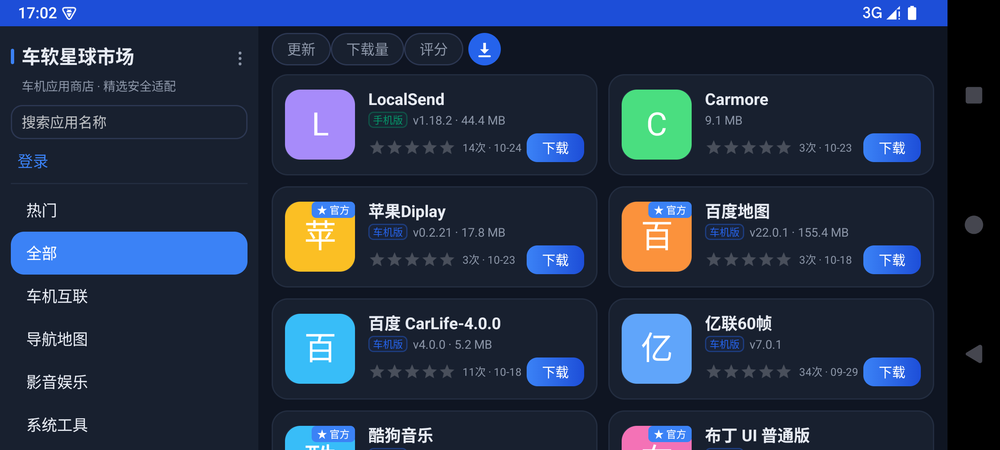
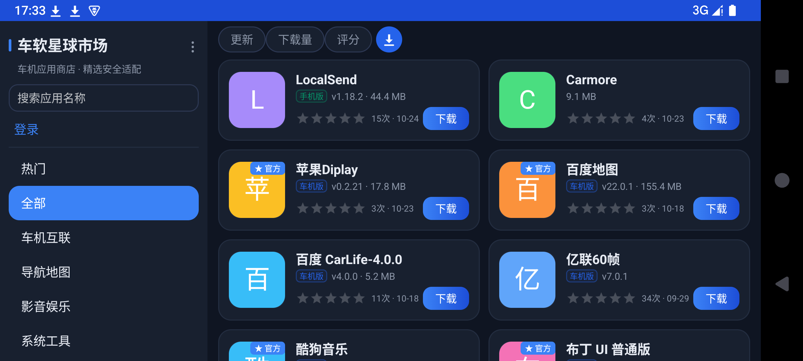
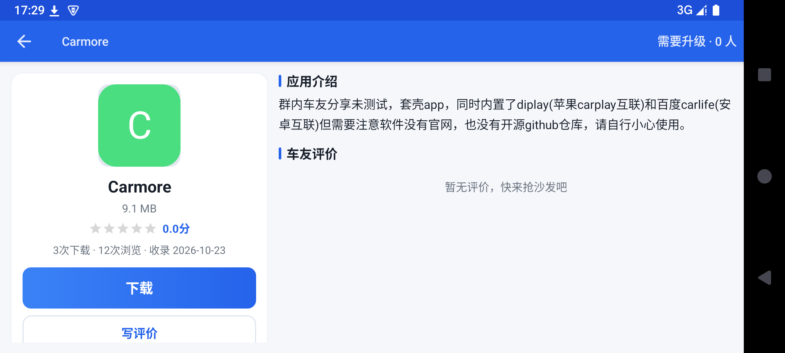
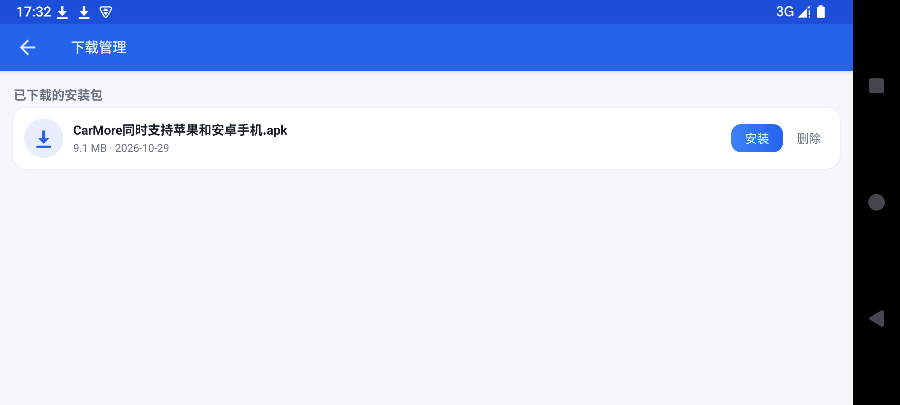
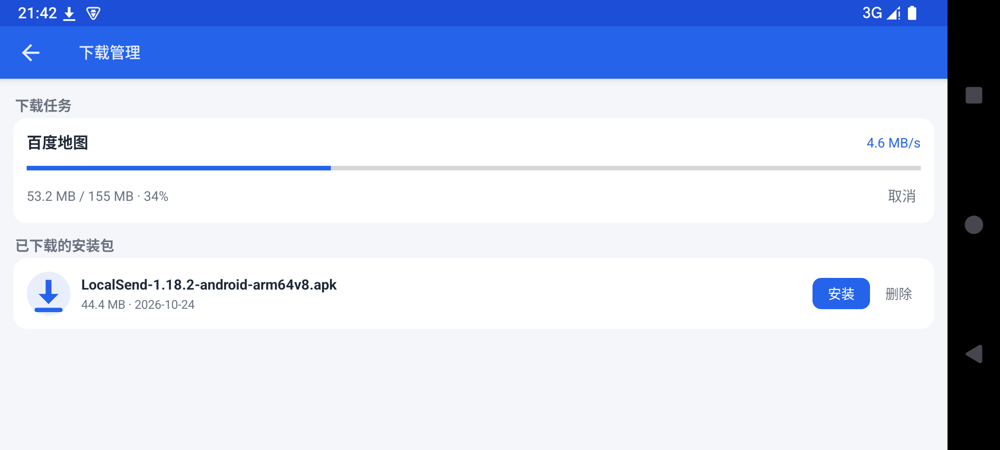

# CarAppMarket · 车软星球市场

> GitHub：<https://github.com/a435630144/CarAppMarket>
> 文档：[HANDOVER.md](HANDOVER.md) 交接文档（接手必读） · [DEVELOPMENT_LOG.md](DEVELOPMENT_LOG.md) 开发日志 · 本 README（功能/兼容/构建）

车软星球市场（CarAppMarket）——车机软件站 **<后端域名>** 的安卓客户端，**主要面向汽车车机横屏大屏**，同时兼容手机。
最低支持 **Android 4.0（API 14）**，可在最新版 Android 上正常安装运行（targetSdk 28，Android 14+ 允许侧载）。

后端接口：`https://<后端域名>/api`（NestJS，仓库见 `<后端仓库>`）。

## 开源协议

本项目基于 **GPL-3.0** 协议开源，完整文本见 [LICENSE](LICENSE)。

## 界面预览

| 浅色 · 车机首页 | 深色 · 车机首页 |
|---|---|
|  |  |

| 深色 · 应用详情 | 下载管理 |
|---|---|
|  |  |

| 下载进度（实时速度） |
|---|---|
|  |

## 功能

- **首页（v1.4.0 重构，对齐车机市场风格）**：左侧分类导航（热门/全部/各分类，选中高亮），
  右侧响应式卡片网格 + 顶部快捷排序（更新/下载量/评分；单击高→低▼、双击低→高▲、三击还原），
  按名称本地搜索；竖屏手机为顶部分类 chips + 单列横条
- **合集/多版本**：合集卡片带「多版本」徽章，详情页可横滑切换历史版本（版本 chip 含大小），
  并展示合集更新日志（数据来自后端 `software` 表 collection 折叠与 `collection` 负载）
- **收录日期**：网格卡片显示短日期（同年 MM-dd / 跨年 yyyy-MM-dd），详情页完整「收录 yyyy-MM-dd」
- **下载管理（v1.5.0）**：卡片右下角下载按钮，点击后飞行动画汇入顶部下载中心图标（Canvas
  矢量绘制，安卓4 无 SVG 支持），运行中任务数红点角标；下载管理页展示进行中任务
  （进度条/实时速度/已下载/取消）与已落盘安装包（大小/日期/安装/删除），全部实时刷新；
  重复下载自动加 (1)(2) 后缀，不覆盖不遗留
- **更新请求（v1.6.0）**：详情页二级菜单「需要升级 · N 人」按钮，对接后端
  `GET/POST /software/:id/update-request`，登录用户与游客（本地 UUID visitorId）均可幂等反馈，
  点击后实时显示「已反馈 · N 人」
- **标识体系（v1.6.0）**：卡片与详情页显示「车机版/手机版」描边标签（后端 type 字段）；
  官方应用使用「★ 官方」实心主色徽章提高辨识度；排序（更新/下载量/评分）与下载中心
  入口左对齐于内容区顶部
- **车机横屏优先布局**：横屏为「左侧栏（搜索/登录/热门）+ 右侧**响应式网格**」——`GridView auto_fit`
  按剩余宽度自动算列数（约 660dp→2 列、1000dp→3 列、1600dp+→5 列，21:9 带鱼屏自动更多列），
  小卡片含图标/名称/版本/评分/下载量；竖屏手机为单列横条列表；详情页横屏左右双栏、竖屏纵向单列
- **详情**：图标/版本/作者/评分/下载量、应用介绍、截图横滑 + 点击全屏、系统要求；图标缺失时按应用名首字生成彩色字母占位图
- **下载安装**：走 OkHttp（Conscrypt TLS）流式下载 + 进度通知，完成后一键唤起系统安装器；
  下载前调用 `POST /software/:id/download` 完成计数并获取直链（自动补全后端返回的相对路径）
- **账号**：邮箱验证码注册、登录、退出（JWT Bearer，对齐 Web 端 `community_token`）
- **评价**：查看评分汇总与全部车友评价、写评价（0.5~5 星 + 文字，重复提交即修改）、评价点赞

## 下载安装

1. 前往 [Releases](https://github.com/a435630144/CarAppMarket/releases) 下载最新 APK
2. 车机 / 手机上打开，按提示允许「安装未知应用」
3. 完成。系统要求：**Android 4.0（API 14）及以上**

**升级**：新版本发布后，应用启动时会自动在侧栏提示「发现新版本」，点击即可完成下载与安装，无需重新下载 APK。

## 常见问题

**Q：车机上刷新不出应用？**
请检查网络连接。针对老款安卓 4.x 系统已内置 TLS 兼容方案，正常网络下可直接使用。

**Q：安装时提示"禁止安装未知来源应用"？**
在系统设置中允许本应用安装未知应用（仅首次需要）。

**Q：下载中途断网了怎么办？**
无需操作：恢复网络后下载会自动断点续传；列表页也会每 15 秒自动重试刷新。

**Q：支持哪些 CPU？**
armeabi-v7a / arm64-v8a / x86 / x86_64 全覆盖，主流车机与手机均可。

## 感谢打赏 ❤️

本项目完全免费开源，用爱发电。如果车软星球市场帮到了你，欢迎请作者喝杯咖啡——
每一份支持都是持续更新的动力 🙏

  

> 支付宝扫一扫即可打赏，金额随意，不强求～
